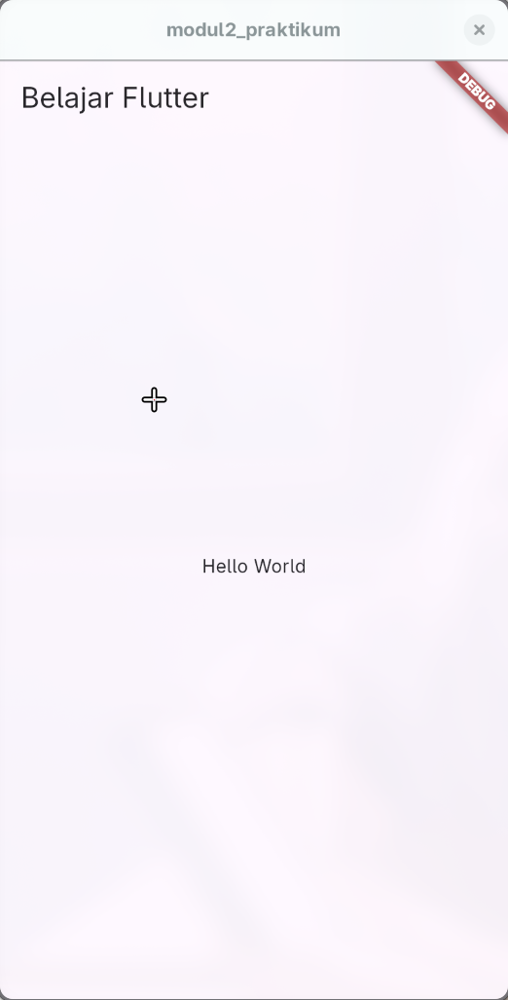
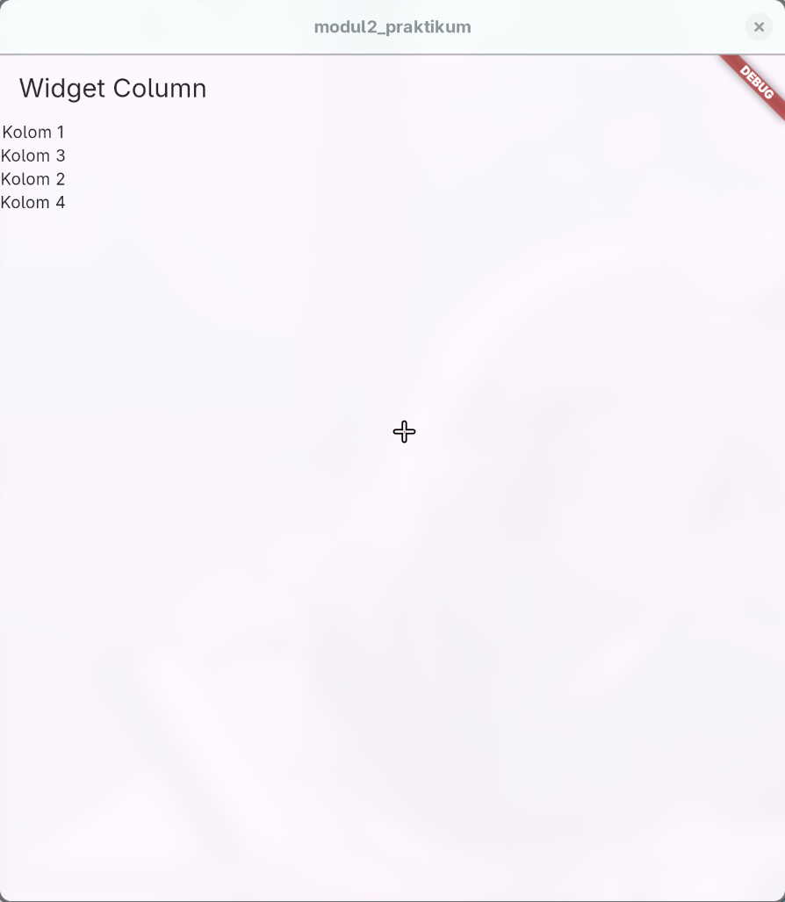
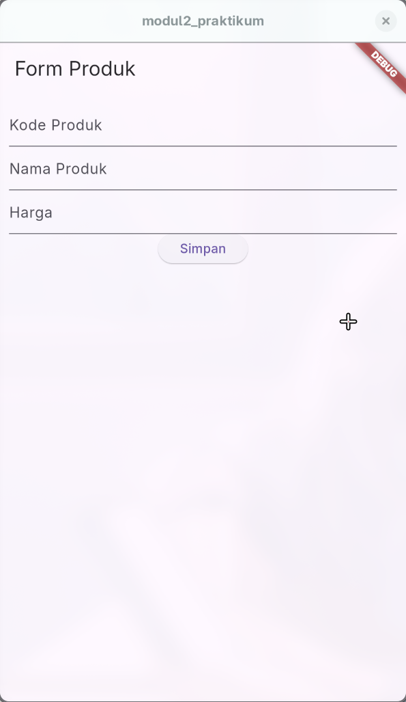
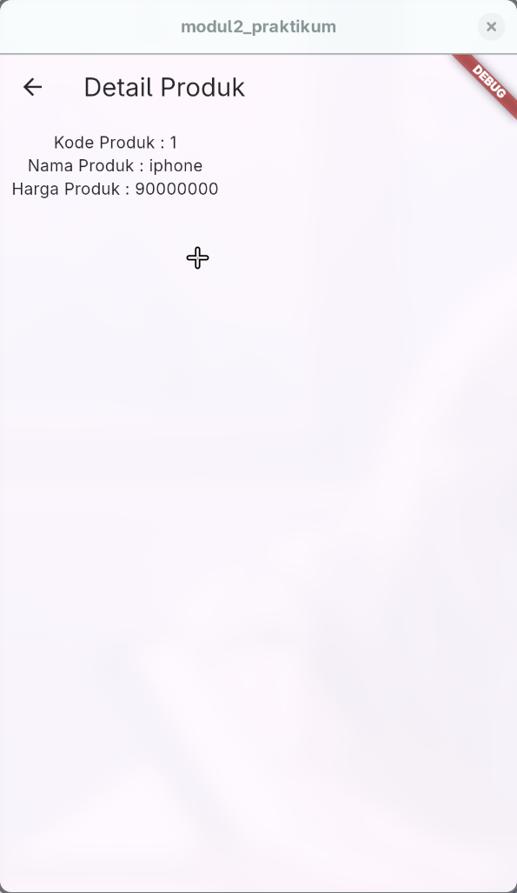
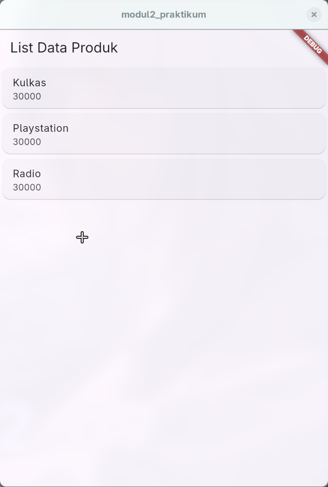

# Output Aplikasi

## Identitas

| | |
|---|---|
| **Nama** | Fahmi Arif Setiawan |
| **NIM** | H1D024014 |
| **Shift Praktikum** | I |

---

## Modul 2

  
  
  
  
  

Pada modul ini dipelajari dasar pembuatan antarmuka Flutter menggunakan widget, mulai dari layout, form input, navigasi antarhalaman, hingga ListView.