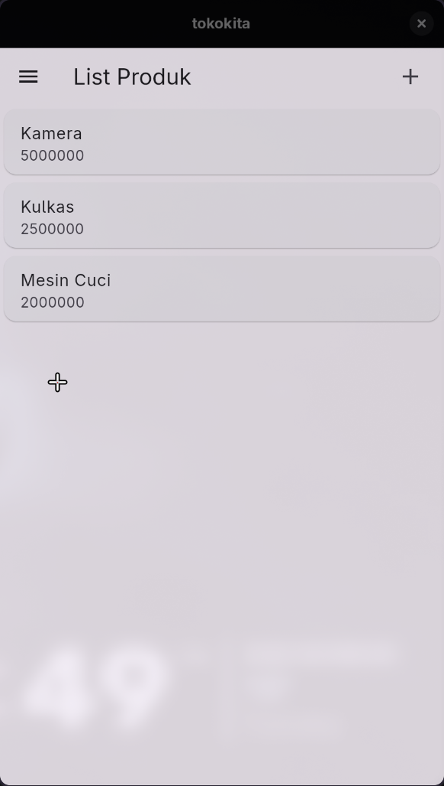
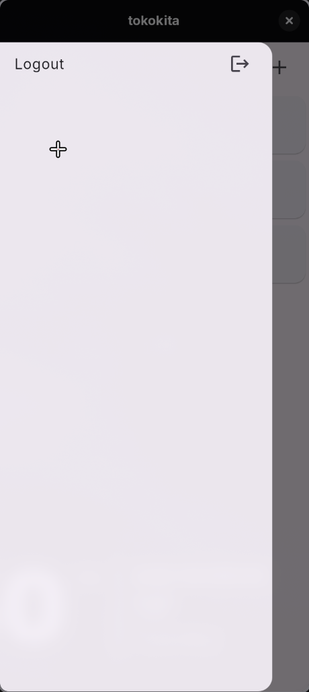
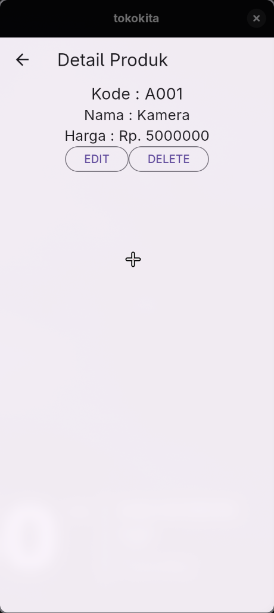
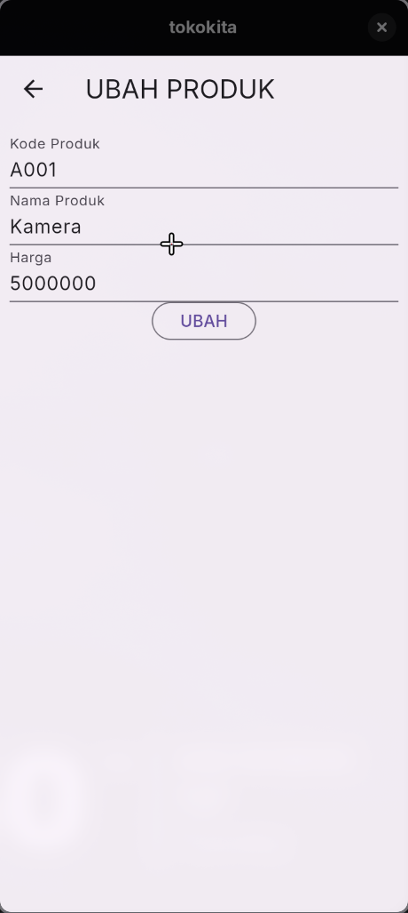
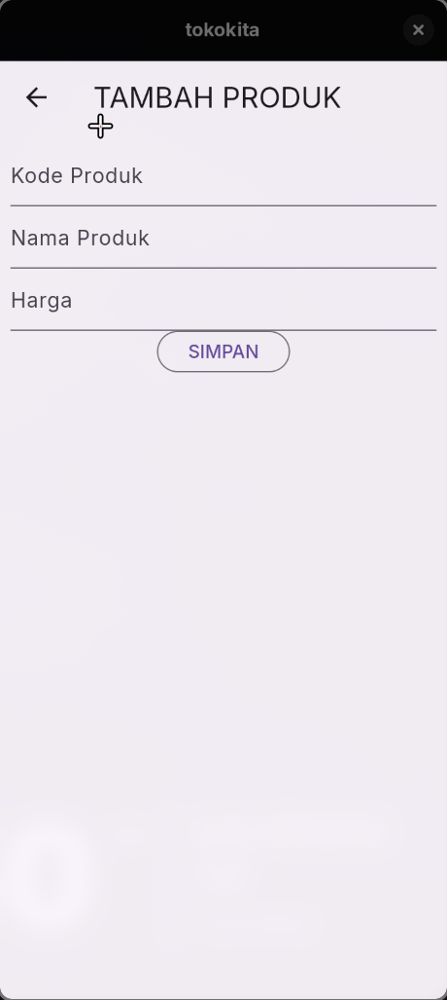
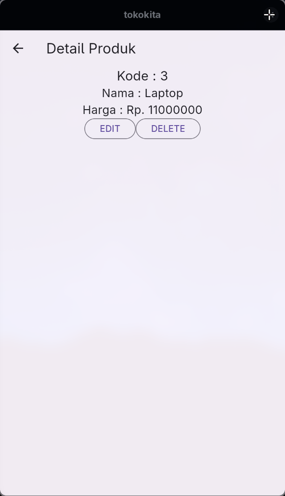

# Output Aplikasi

## Identitas

| | |
|---|---|
| **Nama** | Fahmi Arif Setiawan |
| **NIM** | H1D024014 |
| **Shift Praktikum** | I |

---

## Modul 4

  
  
  
  
  

Pada modul ini dipelajari pembuatan Rest API menggunakan Code Igniter (dapat dilihat pada branch api-/toko-api) dan disambungkan ke flutter untuk menampilkan CRUD produk.

## Modul 5

  
  
  

Pada modul ini dipelajari cara menghubungkan REST API Code Igniter ke flutter, sehingga dapat memuat database (terutama data produk pada kasus ini) yang sama.