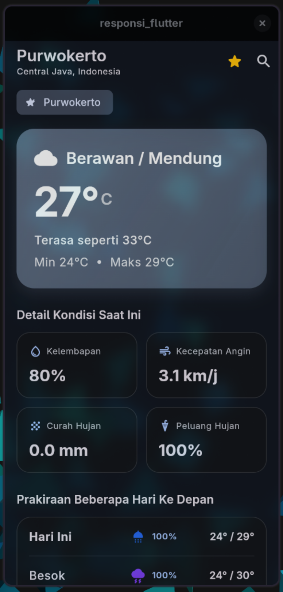
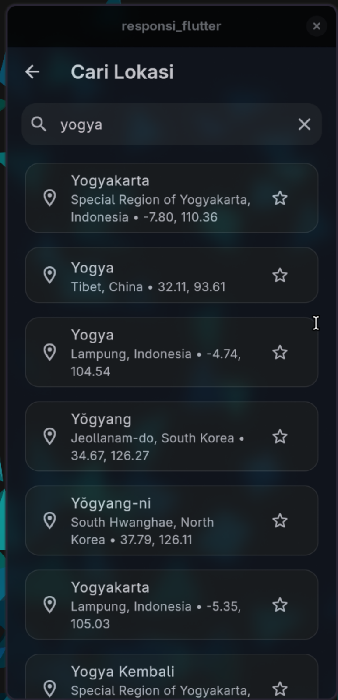
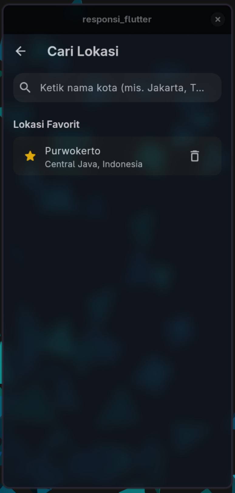

# Identitas
Nama: Fahmi Arif Setiawan
NIM: H1D024014
Shift Praktikum (akhir): i
Shift Praktikum (awal): a

# Responsi Flutter — Aplikasi Cuaca (Open-Meteo)

Aplikasi informasi cuaca berbasis Flutter & Dart menggunakan arsitektur **MVVM** dan REST API dari **Open-Meteo**.

## Fitur Utama
- Menampilkan cuaca terkini (suhu, kondisi cuaca, terasa seperti, kelembapan, kecepatan angin, curah hujan, peluang hujan).
- Menampilkan prakiraan cuaca 7 hari ke depan.
- Pencarian lokasi kota secara real-time menggunakan Open-Meteo Geocoding API.
- Menyimpan lokasi favorit dan riwayat pencarian secara lokal menggunakan `SharedPreferences`.
- Penanganan state `loading`, `empty`, dan `error` dengan tombol coba lagi.

## Struktur Aplikasi (MVVM)
- `lib/models/` — Model data Dart (`LocationModel`, `CurrentWeatherModel`, `DailyForecastModel`, `WeatherResponseModel`).
- `lib/services/` — Layer komunikasi eksternal (`WeatherApiService` untuk HTTP GET Open-Meteo & `LocalStorageService` untuk `SharedPreferences`).
- `lib/viewmodels/` — Pengelola state berbasis `ChangeNotifier` (`WeatherViewModel`, `SearchViewModel`).
- `lib/views/` — Antarmuka Material 3 (`HomeScreen`, `SearchScreen`, serta widget modular).

## Implementasi API
- **Weather Forecast API**: `GET https://api.open-meteo.com/v1/forecast` (`latitude`, `longitude`, `current`, `daily`, `timezone=auto`).
- **Geocoding API**: `GET https://geocoding-api.open-meteo.com/v1/search` (`name`, `count=10`, `format=json`).

## Screenshot Aplikasi
| Home Screen | Search Screen (Filled) | Search Screen (Empty) |
| :---: | :---: | :---: |
|  |  |  |