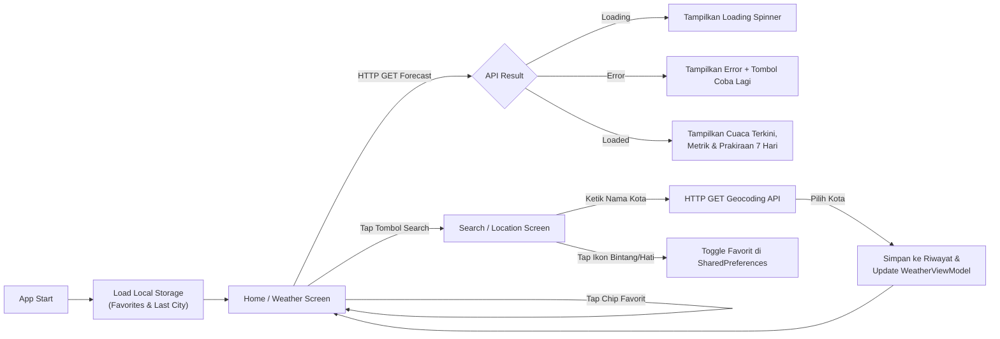
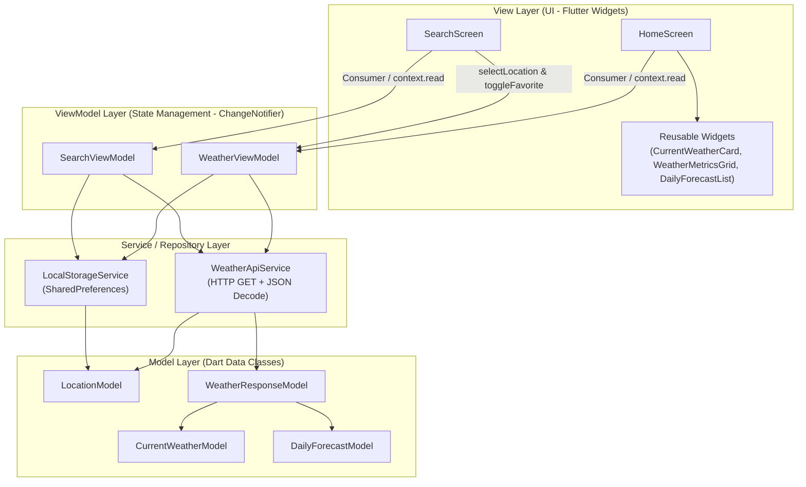

# Product Requirements & Implementation Blueprint (PRD)
# Aplikasi Cuaca Flutter — Open-Meteo (MVVM)

Dokumen ini adalah blueprint lengkap untuk membangun proyek **Responsi Flutter** berdasarkan spesifikasi pada [Responsi Flutter.pdf](file:///home/fahmi/Projects/Flutter/responsi_flutter/docs/Responsi%20Flutter.pdf). Seluruh arsitektur, desain UI, kontrak API, kode siap pakai untuk setiap file, serta urutan implementasi telah disusun agar dapat langsung disalin, dibangun, dan dijelaskan saat pengumpulan.

---

## Daftar Isi
1. [Ringkasan Proyek & Matriks Kesesuaian](#1-ringkasan-proyek--matriks-kesesuaian)
2. [Project Previews (Wireframe & User Flow)](#2-project-previews-wireframe--user-flow)
3. [Arsitektur Aplikasi (MVVM) & Kontrak API](#3-arsitektur-aplikasi-mvvm--kontrak-api)
4. [Struktur Direktori Proyek](#4-struktur-direktori-proyek)
5. [Implementasi Kode per File & Penjelasannya](#5-implementasi-kode-per-file--penjelasannya)
6. [Urutan Implementasi Proyek (Step-by-Step)](#6-urutan-implementasi-proyek-step-by-step)
7. [Checklist Pengumpulan & Panduan README](#7-checklist-pengumpulan--panduan-readme)

---

## 1. Ringkasan Proyek & Matriks Kesesuaian

Aplikasi ini adalah aplikasi informasi cuaca berbasis **Flutter & Dart** menggunakan **Material Design 3**, arsitektur **Model-View-ViewModel (MVVM)**, state management **Provider (`ChangeNotifier`)**, penyimpanan lokal **SharedPreferences**, serta integrasi **HTTP GET REST API** ke **Open-Meteo** (Weather Forecast API & Geocoding API).

### Matriks Kesesuaian Spesifikasi PDF

| Kategori | Persyaratan PDF | Implementasi dalam Blueprint |
| :--- | :--- | :--- |
| **Bahasa** | Dart & Flutter (`StatelessWidget` & `StatefulWidget`) | `StatelessWidget` untuk komponen presentasional & `HomeScreen`; `StatefulWidget` untuk `SearchScreen` (mengelola `TextEditingController` & debounce `Timer`) |
| **UI** | Material Design, Theme konsisten, Typography terbaca, Responsif | `ThemeData(useMaterial3: true)` (Light & Dark theme), `TextTheme` terstruktur, `ConstrainedBox(maxWidth: 840)` & `LayoutBuilder` adaptif |
| **List & Data** | Local Storage untuk favorit &/atau riwayat pencarian, tampil saat dibuka kembali | `SharedPreferences` menyimpan daftar **Lokasi Favorit**, **Riwayat Pencarian**, dan **Lokasi Terakhir** dalam format JSON |
| **State** | Pengelolaan state (`setState`/Provider/Riverpod/BLoC), pencarian kota & pilih lokasi | `Provider` (`ChangeNotifierProvider` + `Consumer`) pada `WeatherViewModel` dan `SearchViewModel` |
| **Networking** | Open-Meteo REST API, HTTP GET, JSON -> Model Dart, tangani loading/empty/error | `package:http` (`client.get`), parsing `fromJson`, enum `ViewState { initial, loading, loaded, empty, error }` |
| **Architecture** | Model-View-ViewModel (MVVM) | Pemisahan tegas `models/`, `services/`, `viewmodels/`, dan `views/` |
| **Minimum Screens** | 1. Home / Weather Screen<br>2. Search / Location Screen | `HomeScreen` (kota, kondisi, suhu, kelembapan, angin, hujan, prakiraan harian, chip favorit) & `SearchScreen` (pencarian API, hasil, favorit, riwayat) |

---

## 2. Project Previews (Wireframe & User Flow)

### 2.1 User Flow



### 2.2 Preview Screen 1 — Home / Weather Screen

```text
+-------------------------------------------------------+
|  Yogyakarta                         [ ★ ]  [ 🔍 ]     |
|  DI Yogyakarta, Indonesia                             |
+-------------------------------------------------------+
|  Favorit: [ ★ Yogyakarta ] [ ★ Jakarta ] [ ★ Bandung ]|
+-------------------------------------------------------+
|  +-------------------------------------------------+  |
|  |   ☀️  Cerah Berawan                             |  |
|  |                                                 |  |
|  |       31°C                                      |  |
|  |       Terasa seperti 35°C                       |  |
|  |       Min 24°C  •  Maks 33°C                    |  |
|  +-------------------------------------------------+  |
|                                                       |
|  Detail Kondisi Saat Ini                              |
|  +-----------------------+ +-----------------------+  |
|  | 💧 Kelembapan         | | 💨 Kecepatan Angin    |  |
|  |    68 %               | |    12.4 km/j          |  |
|  +-----------------------+ +-----------------------+  |
|  +-----------------------+ +-----------------------+  |
|  | 🌧️ Curah Hujan        | | ☔ Peluang Hujan Maks |  |
|  |    0.0 mm             | |    40 %               |  |
|  +-----------------------+ +-----------------------+  |
|                                                       |
|  Prakiraan 7 Hari Ke Depan                            |
|  +-------------------------------------------------+  |
|  | Hari Ini     ☀️   💧 40%    24°C  [====]  33°C   |  |
|  | Kam, 26 Nov  🌦️   💧 70%    23°C  [=== ]  30°C   |  |
|  | Jum, 27 Nov  ⛈️   💧 85%    22°C  [==  ]  29°C   |  |
|  | Sab, 28 Nov  ⛅   💧 20%    24°C  [====]  32°C   |  |
|  +-------------------------------------------------+  |
+-------------------------------------------------------+
```

### 2.3 Preview Screen 2 — Search / Location Screen

```text
+-------------------------------------------------------+
|  [ ← ]  Cari Lokasi                                   |
+-------------------------------------------------------+
|  +-------------------------------------------------+  |
|  | 🔍  Cari nama kota (mis. Jakarta, Tokyo)... [✕] |  |
|  +-------------------------------------------------+  |
|                                                       |
|  -- Saat input terisi (Hasil Geocoding API) --        |
|  Hasil Pencarian                                      |
|  +-------------------------------------------------+  |
|  | 📍 Bandung                              [ ☆ ]   |  |
|  |    Jawa Barat, Indonesia • -6.92, 107.61        |  |
|  +-------------------------------------------------+  |
|  | 📍 Bandar Lampung                       [ ★ ]   |  |
|  |    Lampung, Indonesia • -5.43, 105.26           |  |
|  +-------------------------------------------------+  |
|                                                       |
|  -- Saat input kosong (Data dari SharedPreferences) --|
|  Lokasi Favorit                                       |
|  +-------------------------------------------------+  |
|  | ★  Yogyakarta — DI Yogyakarta, Indonesia   [ ✕ ]|  |
|  | ★  Jakarta — Jakarta, Indonesia            [ ✕ ]|  |
|  +-------------------------------------------------+  |
|                                                       |
|  Riwayat Pencarian                    [ Hapus Semua ] |
|  +-------------------------------------------------+  |
|  | 🕒 Surabaya — Jawa Timur, Indonesia        [ ✕ ]|  |
|  | 🕒 Tokyo — Tokyo, Japan                    [ ✕ ]|  |
|  +-------------------------------------------------+  |
+-------------------------------------------------------+
```

### 2.4 Preview State Feedback (Loading, Empty, Error)

```text
[ LOADING ]                  [ EMPTY ]                    [ ERROR ]
+----------------------+     +----------------------+     +----------------------+
|                      |     |          🔍          |     |         ⚠️           |
|     ( ⟳ spinner )    |     |  Lokasi tidak        |     | Gagal memuat cuaca   |
|  Memuat data cuaca   |     |  ditemukan           |     | Periksa koneksi      |
|                      |     |  Coba kata kunci lain|     |   [ Coba Lagi ]      |
+----------------------+     +----------------------+     +----------------------+
```

---

## 3. Arsitektur Aplikasi (MVVM) & Kontrak API

### 3.1 Diagram Arsitektur MVVM



**Alur Kerja MVVM:**
1. **Model (`lib/models/`)**: Struktur data murni Dart yang memetakan respons JSON Open-Meteo dan data lokasi ke objek bertipe kuat (*type-safe*), lengkap dengan `fromJson` dan `toJson`.
2. **Service (`lib/services/`)**: Bertanggung jawab atas komunikasi eksternal — `WeatherApiService` melakukan HTTP GET ke API Open-Meteo, sedangkan `LocalStorageService` membaca/menulis data ke `SharedPreferences`.
3. **ViewModel (`lib/viewmodels/`)**: Memegang *state* layar (`ViewState`: `initial`, `loading`, `loaded`, `empty`, `error`), memanggil Service secara asinkron, mengolah error, dan memanggil `notifyListeners()` agar UI ter-rebuild otomatis.
4. **View (`lib/views/`)**: Hanya merender UI berdasarkan *state* dari ViewModel serta meneruskan aksi pengguna (tap, search, pull-to-refresh, toggle favorit) ke method ViewModel. View **tidak pernah** melakukan HTTP request atau mengakses `SharedPreferences` secara langsung.

---

### 3.2 Kontrak Open-Meteo REST API

#### A. Weather Forecast API
- **Method**: `GET`
- **Base URL**: `https://api.open-meteo.com/v1/forecast`
- **Query Parameters**:
  - `latitude`: koordinat lintang (contoh: `-7.7956`)
  - `longitude`: koordinat bujur (contoh: `110.3695`)
  - `current`: `temperature_2m,relative_humidity_2m,apparent_temperature,precipitation,weather_code,wind_speed_10m,is_day`
  - `daily`: `weather_code,temperature_2m_max,temperature_2m_min,precipitation_probability_max`
  - `timezone`: `auto`
  - `forecast_days`: `7`

**Contoh URL Request:**
```text
https://api.open-meteo.com/v1/forecast?latitude=-7.7956&longitude=110.3695&current=temperature_2m,relative_humidity_2m,apparent_temperature,precipitation,weather_code,wind_speed_10m,is_day&daily=weather_code,temperature_2m_max,temperature_2m_min,precipitation_probability_max&timezone=auto&forecast_days=7
```

**Pemetaan Field PDF ke Model:**

| Kebutuhan PDF | Field JSON Open-Meteo | Properti Model Dart |
| :--- | :--- | :--- |
| Suhu saat ini | `current.temperature_2m` | `CurrentWeatherModel.temperature2m` |
| Kelembapan | `current.relative_humidity_2m` | `CurrentWeatherModel.relativeHumidity2m` |
| Suhu yang dirasakan | `current.apparent_temperature` | `CurrentWeatherModel.apparentTemperature` |
| Curah hujan | `current.precipitation` | `CurrentWeatherModel.precipitation` |
| Kode kondisi cuaca | `current.weather_code` | `CurrentWeatherModel.weatherCode` |
| Kecepatan angin | `current.wind_speed_10m` | `CurrentWeatherModel.windSpeed10m` |
| Suhu maksimum harian | `daily.temperature_2m_max` | `DailyForecastModel.temperatureMax` |
| Suhu minimum harian | `daily.temperature_2m_min` | `DailyForecastModel.temperatureMin` |
| Peluang hujan maksimum | `daily.precipitation_probability_max` | `DailyForecastModel.precipitationProbabilityMax` |

#### B. Geocoding API (Pencarian Kota)
- **Method**: `GET`
- **Base URL**: `https://geocoding-api.open-meteo.com/v1/search`
- **Query Parameters**:
  - `name`: nama kota yang dicari (contoh: `Jakarta`)
  - `count`: `10`
  - `language`: `en`
  - `format`: `json`

**Contoh URL Request:**
```text
https://geocoding-api.open-meteo.com/v1/search?name=Jakarta&count=10&language=en&format=json
```
> **Catatan Penting:** Jika tidak ada kota yang cocok, Geocoding API Open-Meteo mengembalikan JSON tanpa key `"results"` (`{"generationtime_ms": ...}`). Kode model & service harus menangani `json['results'] == null` sebagai list kosong (`[]`) dan mengubah state menjadi `ViewState.empty`.

---

## 4. Struktur Direktori Proyek

```text
responsi_flutter/
├── pubspec.yaml
├── README.md
├── docs/
│   ├── Responsi Flutter.pdf
│   └── prd.md
├── lib/
│   ├── main.dart
│   ├── core/
│   │   ├── constants/
│   │   │   └── api_constants.dart
│   │   ├── theme/
│   │   │   └── app_theme.dart
│   │   └── utils/
│   │       ├── date_formatter.dart
│   │       └── weather_code_mapper.dart
│   ├── models/
│   │   ├── current_weather_model.dart
│   │   ├── daily_forecast_model.dart
│   │   ├── location_model.dart
│   │   └── weather_response_model.dart
│   ├── services/
│   │   ├── local_storage_service.dart
│   │   └── weather_api_service.dart
│   ├── viewmodels/
│   │   ├── search_viewmodel.dart
│   │   └── weather_viewmodel.dart
│   └── views/
│       ├── screens/
│       │   ├── home_screen.dart
│       │   └── search_screen.dart
│       └── widgets/
│           ├── current_weather_card.dart
│           ├── daily_forecast_list.dart
│           ├── state_feedback_view.dart
│           └── weather_metrics_grid.dart
└── test/
    └── widget_test.dart
```

---

## 5. Implementasi Kode per File & Penjelasannya

> Seluruh kode di bawah ini mematuhi `flutter_lints: ^6.0.0`, Dart SDK `^3.11.0`, dan Material 3 tanpa API deprecated.

---

### 5.1 `pubspec.yaml`
**Deskripsi:** Mendefinisikan dependensi proyek. Kita menggunakan `http` untuk HTTP GET REST API secara eksplisit (memenuhi syarat HTTP GET & parsing JSON), `provider` untuk state management MVVM (`ChangeNotifier`), dan `shared_preferences` untuk Local Storage.

```yaml
name: responsi_flutter
description: "Aplikasi Cuaca Flutter berbasis Open-Meteo dengan arsitektur MVVM."
publish_to: 'none'
version: 1.0.0+1

environment:
  sdk: ^3.11.0

dependencies:
  flutter:
    sdk: flutter
  cupertino_icons: ^1.0.8
  http: ^1.2.2
  provider: ^6.1.2
  shared_preferences: ^2.3.2

dev_dependencies:
  flutter_test:
    sdk: flutter
  flutter_lints: ^6.0.0

flutter:
  uses-material-design: true
```

---

### 5.2 `lib/core/constants/api_constants.dart`
**Deskripsi:** Menyimpan seluruh konstanta URL endpoint, parameter query Open-Meteo, key `SharedPreferences`, serta koordinat kota awal default (hanya dipakai jika belum ada lokasi tersimpan pada peluncuran pertama — data cuaca tetap 100% diambil dari API secara live).

```dart
import 'package:responsi_flutter/models/location_model.dart';

class ApiConstants {
  ApiConstants._();

  static const String weatherHost = 'api.open-meteo.com';
  static const String weatherPath = '/v1/forecast';

  static const String geocodingHost = 'geocoding-api.open-meteo.com';
  static const String geocodingPath = '/v1/search';

  static const String currentFields =
      'temperature_2m,relative_humidity_2m,apparent_temperature,precipitation,weather_code,wind_speed_10m,is_day';

  static const String dailyFields =
      'weather_code,temperature_2m_max,temperature_2m_min,precipitation_probability_max';

  static const Duration requestTimeout = Duration(seconds: 15);

  /// Lokasi awal default saat aplikasi pertama kali dibuka dan local storage kosong.
  /// Data cuaca tetap diambil langsung dari Open-Meteo API, bukan hardcoded.
  static const LocationModel defaultLocation = LocationModel(
    id: 1621177,
    name: 'Yogyakarta',
    latitude: -7.7956,
    longitude: 110.3695,
    country: 'Indonesia',
    admin1: 'Special Region of Yogyakarta',
  );
}
```

---

### 5.3 `lib/core/theme/app_theme.dart`
**Deskripsi:** Mengatur tema Material 3 (Light & Dark) secara terpusat, termasuk palet warna (`ColorScheme.fromSeed`), tipografi (`TextTheme`) yang kontras dan mudah dibaca, serta gaya input field agar seluruh screen tampil konsisten.

```dart
import 'package:flutter/material.dart';

class AppTheme {
  AppTheme._();

  static const Color _seedColor = Color(0xFF1565C0);

  static ThemeData get lightTheme {
    final colorScheme = ColorScheme.fromSeed(
      seedColor: _seedColor,
      brightness: Brightness.light,
    );

    return ThemeData(
      useMaterial3: true,
      colorScheme: colorScheme,
      scaffoldBackgroundColor: const Color(0xFFF5F7FB),
      appBarTheme: AppBarTheme(
        centerTitle: false,
        elevation: 0,
        scrolledUnderElevation: 1,
        backgroundColor: const Color(0xFFF5F7FB),
        foregroundColor: colorScheme.onSurface,
      ),
      textTheme: _buildTextTheme(ThemeData.light().textTheme, colorScheme),
      inputDecorationTheme: InputDecorationTheme(
        filled: true,
        fillColor: colorScheme.surfaceContainerHighest.withValues(alpha: 0.55),
        border: OutlineInputBorder(
          borderRadius: BorderRadius.circular(16),
          borderSide: BorderSide.none,
        ),
        focusedBorder: OutlineInputBorder(
          borderRadius: BorderRadius.circular(16),
          borderSide: BorderSide(color: colorScheme.primary, width: 1.5),
        ),
        contentPadding: const EdgeInsets.symmetric(horizontal: 16, vertical: 14),
      ),
    );
  }

  static ThemeData get darkTheme {
    final colorScheme = ColorScheme.fromSeed(
      seedColor: _seedColor,
      brightness: Brightness.dark,
    );

    return ThemeData(
      useMaterial3: true,
      colorScheme: colorScheme,
      scaffoldBackgroundColor: const Color(0xFF0F141D),
      appBarTheme: AppBarTheme(
        centerTitle: false,
        elevation: 0,
        scrolledUnderElevation: 1,
        backgroundColor: const Color(0xFF0F141D),
        foregroundColor: colorScheme.onSurface,
      ),
      textTheme: _buildTextTheme(ThemeData.dark().textTheme, colorScheme),
      inputDecorationTheme: InputDecorationTheme(
        filled: true,
        fillColor: colorScheme.surfaceContainerHighest.withValues(alpha: 0.45),
        border: OutlineInputBorder(
          borderRadius: BorderRadius.circular(16),
          borderSide: BorderSide.none,
        ),
        focusedBorder: OutlineInputBorder(
          borderRadius: BorderRadius.circular(16),
          borderSide: BorderSide(color: colorScheme.primary, width: 1.5),
        ),
        contentPadding: const EdgeInsets.symmetric(horizontal: 16, vertical: 14),
      ),
    );
  }

  static TextTheme _buildTextTheme(TextTheme base, ColorScheme colorScheme) {
    return base.copyWith(
      displayLarge: base.displayLarge?.copyWith(
        fontSize: 56,
        fontWeight: FontWeight.w700,
        letterSpacing: -1.5,
      ),
      headlineSmall: base.headlineSmall?.copyWith(
        fontWeight: FontWeight.w700,
      ),
      titleLarge: base.titleLarge?.copyWith(
        fontWeight: FontWeight.w600,
      ),
      titleMedium: base.titleMedium?.copyWith(
        fontWeight: FontWeight.w600,
      ),
      bodyMedium: base.bodyMedium?.copyWith(
        color: colorScheme.onSurfaceVariant,
      ),
    );
  }
}
```

---

### 5.4 `lib/core/utils/weather_code_mapper.dart`
**Deskripsi:** Mengonversi nilai integer `weather_code` standar WMO dari Open-Meteo menjadi label kondisi cuaca berbahasa Indonesia, ikon Material yang sesuai (termasuk kondisi siang/malam untuk cerah), dan warna aksen visual.

```dart
import 'package:flutter/material.dart';

class WeatherInfo {
  final String label;
  final IconData icon;
  final Color color;

  const WeatherInfo({
    required this.label,
    required this.icon,
    required this.color,
  });
}

class WeatherCodeMapper {
  WeatherCodeMapper._();

  static WeatherInfo fromCode(int code, {bool isDay = true}) {
    switch (code) {
      case 0:
        return WeatherInfo(
          label: isDay ? 'Cerah' : 'Malam Cerah',
          icon: isDay ? Icons.wb_sunny_rounded : Icons.nightlight_round,
          color: isDay ? const Color(0xFFF59E0B) : const Color(0xFF6366F1),
        );
      case 1:
        return WeatherInfo(
          label: 'Umumnya Cerah',
          icon: isDay ? Icons.wb_sunny_outlined : Icons.nights_stay_outlined,
          color: const Color(0xFFF59E0B),
        );
      case 2:
        return const WeatherInfo(
          label: 'Berawan Sebagian',
          icon: Icons.cloud_queue_rounded,
          color: Color(0xFF3B82F6),
        );
      case 3:
        return const WeatherInfo(
          label: 'Berawan / Mendung',
          icon: Icons.cloud_rounded,
          color: Color(0xFF64748B),
        );
      case 45:
      case 48:
        return const WeatherInfo(
          label: 'Berkabut',
          icon: Icons.foggy,
          color: Color(0xFF94A3B8),
        );
      case 51:
      case 53:
      case 55:
      case 56:
      case 57:
        return const WeatherInfo(
          label: 'Gerimis',
          icon: Icons.grain_rounded,
          color: Color(0xFF0EA5E9),
        );
      case 61:
      case 63:
      case 66:
        return const WeatherInfo(
          label: 'Hujan Ringan - Sedang',
          icon: Icons.water_drop_rounded,
          color: Color(0xFF0284C7),
        );
      case 65:
      case 67:
        return const WeatherInfo(
          label: 'Hujan Lebat',
          icon: Icons.umbrella_rounded,
          color: Color(0xFF1D4ED8),
        );
      case 71:
      case 73:
      case 75:
      case 77:
      case 85:
      case 86:
        return const WeatherInfo(
          label: 'Salju',
          icon: Icons.ac_unit_rounded,
          color: Color(0xFF38BDF8),
        );
      case 80:
      case 81:
      case 82:
        return const WeatherInfo(
          label: 'Hujan Deras Sesaat',
          icon: Icons.shower_rounded,
          color: Color(0xFF2563EB),
        );
      case 95:
      case 96:
      case 99:
        return const WeatherInfo(
          label: 'Badai Petir',
          icon: Icons.thunderstorm_rounded,
          color: Color(0xFF7C3AED),
        );
      default:
        return const WeatherInfo(
          label: 'Tidak Diketahui',
          icon: Icons.help_outline_rounded,
          color: Color(0xFF64748B),
        );
    }
  }
}
```

---

### 5.5 `lib/core/utils/date_formatter.dart`
**Deskripsi:** Helper ringan untuk memformat tanggal ISO (`YYYY-MM-DD`) dari array `daily.time` Open-Meteo menjadi label hari berbahasa Indonesia (`Hari Ini`, `Besok`, `Kam, 26 Nov`) tanpa perlu menambah dependensi eksternal.

```dart
class DateFormatter {
  DateFormatter._();

  static const List<String> _days = [
    'Sen',
    'Sel',
    'Rab',
    'Kam',
    'Jum',
    'Sab',
    'Min',
  ];

  static const List<String> _months = [
    'Jan',
    'Feb',
    'Mar',
    'Apr',
    'Mei',
    'Jun',
    'Jul',
    'Agu',
    'Sep',
    'Okt',
    'Nov',
    'Des',
  ];

  /// Mengubah string tanggal ISO ("2026-11-25") menjadi label mudah dibaca.
  static String formatForecastDate(String isoDate, {int index = -1}) {
    if (index == 0) return 'Hari Ini';
    if (index == 1) return 'Besok';

    final parsed = DateTime.tryParse(isoDate);
    if (parsed == null) return isoDate;

    final dayName = _days[parsed.weekday - 1];
    final monthName = _months[parsed.month - 1];
    return '$dayName, ${parsed.day} $monthName';
  }
}
```

---

### 5.6 `lib/models/location_model.dart`
**Deskripsi:** Merepresentasikan lokasi kota dari Open-Meteo Geocoding API sekaligus struktur data yang diserialisasi ke JSON untuk disimpan di `SharedPreferences` (favorit, riwayat pencarian, dan lokasi terakhir). Overriding `==` dan `hashCode` memudahkan pengecekan apakah kota sudah ada di daftar favorit.

```dart
class LocationModel {
  final int id;
  final String name;
  final double latitude;
  final double longitude;
  final String? country;
  final String? admin1;

  const LocationModel({
    required this.id,
    required this.name,
    required this.latitude,
    required this.longitude,
    this.country,
    this.admin1,
  });

  factory LocationModel.fromGeocodingJson(Map<String, dynamic> json) {
    return LocationModel(
      id: (json['id'] as num?)?.toInt() ??
          '${json['latitude']}_${json['longitude']}'.hashCode,
      name: (json['name'] as String?) ?? 'Unknown',
      latitude: (json['latitude'] as num).toDouble(),
      longitude: (json['longitude'] as num).toDouble(),
      country: json['country'] as String?,
      admin1: json['admin1'] as String?,
    );
  }

  factory LocationModel.fromJson(Map<String, dynamic> json) {
    return LocationModel(
      id: (json['id'] as num).toInt(),
      name: json['name'] as String,
      latitude: (json['latitude'] as num).toDouble(),
      longitude: (json['longitude'] as num).toDouble(),
      country: json['country'] as String?,
      admin1: json['admin1'] as String?,
    );
  }

  Map<String, dynamic> toJson() {
    return {
      'id': id,
      'name': name,
      'latitude': latitude,
      'longitude': longitude,
      'country': country,
      'admin1': admin1,
    };
  }

  String get subtitle {
    final parts = <String>[
      if (admin1 != null && admin1!.trim().isNotEmpty) admin1!.trim(),
      if (country != null && country!.trim().isNotEmpty) country!.trim(),
    ];
    return parts.isEmpty
        ? '${latitude.toStringAsFixed(2)}, ${longitude.toStringAsFixed(2)}'
        : parts.join(', ');
  }

  @override
  bool operator ==(Object other) {
    if (identical(this, other)) return true;
    return other is LocationModel &&
        other.id == id &&
        other.latitude == latitude &&
        other.longitude == longitude;
  }

  @override
  int get hashCode => Object.hash(id, latitude, longitude);
}
```

---

### 5.7 `lib/models/current_weather_model.dart`
**Deskripsi:** Model Dart untuk objek `current` pada respons Open-Meteo Forecast API. Mencakup seluruh field wajib di PDF (`temperature_2m`, `relative_humidity_2m`, `apparent_temperature`, `precipitation`, `weather_code`, `wind_speed_10m`) ditambah `is_day` dan `time`.

```dart
class CurrentWeatherModel {
  final double temperature2m;
  final int relativeHumidity2m;
  final double apparentTemperature;
  final double precipitation;
  final int weatherCode;
  final double windSpeed10m;
  final bool isDay;
  final String time;

  const CurrentWeatherModel({
    required this.temperature2m,
    required this.relativeHumidity2m,
    required this.apparentTemperature,
    required this.precipitation,
    required this.weatherCode,
    required this.windSpeed10m,
    required this.isDay,
    required this.time,
  });

  factory CurrentWeatherModel.fromJson(Map<String, dynamic> json) {
    return CurrentWeatherModel(
      temperature2m: (json['temperature_2m'] as num?)?.toDouble() ?? 0.0,
      relativeHumidity2m:
          (json['relative_humidity_2m'] as num?)?.toInt() ?? 0,
      apparentTemperature:
          (json['apparent_temperature'] as num?)?.toDouble() ?? 0.0,
      precipitation: (json['precipitation'] as num?)?.toDouble() ?? 0.0,
      weatherCode: (json['weather_code'] as num?)?.toInt() ?? 0,
      windSpeed10m: (json['wind_speed_10m'] as num?)?.toDouble() ?? 0.0,
      isDay: ((json['is_day'] as num?)?.toInt() ?? 1) == 1,
      time: (json['time'] as String?) ?? '',
    );
  }
}
```

---

### 5.8 `lib/models/daily_forecast_model.dart`
**Deskripsi:** Model Dart untuk satu hari prakiraan cuaca. Open-Meteo mengembalikan data `daily` dalam bentuk *parallel arrays* (`time[]`, `weather_code[]`, `temperature_2m_max[]`, `temperature_2m_min[]`, `precipitation_probability_max[]`), sehingga method statis `fromDailyJson` menggabungkannya menjadi `List<DailyForecastModel>` yang rapi.

```dart
class DailyForecastModel {
  final String date;
  final int weatherCode;
  final double temperatureMax;
  final double temperatureMin;
  final int precipitationProbabilityMax;

  const DailyForecastModel({
    required this.date,
    required this.weatherCode,
    required this.temperatureMax,
    required this.temperatureMin,
    required this.precipitationProbabilityMax,
  });

  static List<DailyForecastModel> fromDailyJson(Map<String, dynamic> json) {
    final times = (json['time'] as List<dynamic>?) ?? const [];
    final codes = (json['weather_code'] as List<dynamic>?) ?? const [];
    final maxTemps =
        (json['temperature_2m_max'] as List<dynamic>?) ?? const [];
    final minTemps =
        (json['temperature_2m_min'] as List<dynamic>?) ?? const [];
    final rainProbs =
        (json['precipitation_probability_max'] as List<dynamic>?) ?? const [];

    final count = times.length;
    final forecasts = <DailyForecastModel>[];

    for (var i = 0; i < count; i++) {
      forecasts.add(
        DailyForecastModel(
          date: times[i]?.toString() ?? '',
          weatherCode: i < codes.length && codes[i] != null
              ? (codes[i] as num).toInt()
              : 0,
          temperatureMax: i < maxTemps.length && maxTemps[i] != null
              ? (maxTemps[i] as num).toDouble()
              : 0.0,
          temperatureMin: i < minTemps.length && minTemps[i] != null
              ? (minTemps[i] as num).toDouble()
              : 0.0,
          precipitationProbabilityMax:
              i < rainProbs.length && rainProbs[i] != null
                  ? (rainProbs[i] as num).toInt()
                  : 0,
        ),
      );
    }

    return forecasts;
  }
}
```

---

### 5.9 `lib/models/weather_response_model.dart`
**Deskripsi:** Model root yang menyatukan metadata koordinat, `timezone`, `CurrentWeatherModel`, dan `List<DailyForecastModel>` dari satu panggilan Forecast API.

```dart
import 'package:responsi_flutter/models/current_weather_model.dart';
import 'package:responsi_flutter/models/daily_forecast_model.dart';

class WeatherResponseModel {
  final double latitude;
  final double longitude;
  final String timezone;
  final CurrentWeatherModel current;
  final List<DailyForecastModel> daily;

  const WeatherResponseModel({
    required this.latitude,
    required this.longitude,
    required this.timezone,
    required this.current,
    required this.daily,
  });

  factory WeatherResponseModel.fromJson(Map<String, dynamic> json) {
    final currentMap = (json['current'] as Map<String, dynamic>?) ?? {};
    final dailyMap = (json['daily'] as Map<String, dynamic>?) ?? {};

    return WeatherResponseModel(
      latitude: (json['latitude'] as num?)?.toDouble() ?? 0.0,
      longitude: (json['longitude'] as num?)?.toDouble() ?? 0.0,
      timezone: (json['timezone'] as String?) ?? 'auto',
      current: CurrentWeatherModel.fromJson(currentMap),
      daily: DailyForecastModel.fromDailyJson(dailyMap),
    );
  }
}
```

---

### 5.10 `lib/services/weather_api_service.dart`
**Deskripsi:** Layer Service untuk melakukan HTTP GET request ke Open-Meteo Weather Forecast API dan Geocoding API. Menangani timeout, status code non-200, kegagalan koneksi (`SocketException` / `ClientException`), dan format JSON tidak valid dengan melempar `ApiException` yang informatif.

```dart
import 'dart:async';
import 'dart:convert';

import 'package:http/http.dart' as http;
import 'package:responsi_flutter/core/constants/api_constants.dart';
import 'package:responsi_flutter/models/location_model.dart';
import 'package:responsi_flutter/models/weather_response_model.dart';

class ApiException implements Exception {
  final String message;
  final int? statusCode;

  const ApiException(this.message, {this.statusCode});

  @override
  String toString() => message;
}

class WeatherApiService {
  final http.Client _client;

  WeatherApiService({http.Client? client}) : _client = client ?? http.Client();

  /// Mengambil data cuaca terkini & prakiraan harian via HTTP GET Open-Meteo.
  Future<WeatherResponseModel> fetchWeather({
    required double latitude,
    required double longitude,
  }) async {
    final uri = Uri.https(
      ApiConstants.weatherHost,
      ApiConstants.weatherPath,
      {
        'latitude': latitude.toString(),
        'longitude': longitude.toString(),
        'current': ApiConstants.currentFields,
        'daily': ApiConstants.dailyFields,
        'timezone': 'auto',
        'forecast_days': '7',
      },
    );

    final jsonMap = await _getJson(uri);
    if (!jsonMap.containsKey('current') || !jsonMap.containsKey('daily')) {
      throw const ApiException('Data cuaca dari server tidak lengkap.');
    }
    return WeatherResponseModel.fromJson(jsonMap);
  }

  /// Mencari daftar kota berdasarkan nama via Open-Meteo Geocoding API.
  Future<List<LocationModel>> searchLocations(String query) async {
    final trimmed = query.trim();
    if (trimmed.isEmpty) return const [];

    final uri = Uri.https(
      ApiConstants.geocodingHost,
      ApiConstants.geocodingPath,
      {
        'name': trimmed,
        'count': '10',
        'language': 'en',
        'format': 'json',
      },
    );

    final jsonMap = await _getJson(uri);
    final results = jsonMap['results'] as List<dynamic>?;
    if (results == null || results.isEmpty) {
      return const [];
    }

    return results
        .whereType<Map<String, dynamic>>()
        .map(LocationModel.fromGeocodingJson)
        .toList();
  }

  Future<Map<String, dynamic>> _getJson(Uri uri) async {
    try {
      final response = await _client
          .get(uri, headers: const {'Accept': 'application/json'})
          .timeout(ApiConstants.requestTimeout);

      if (response.statusCode != 200) {
        throw ApiException(
          'Permintaan API gagal (kode ${response.statusCode}).',
          statusCode: response.statusCode,
        );
      }

      final decoded = jsonDecode(response.body);
      if (decoded is! Map<String, dynamic>) {
        throw const ApiException('Format respons JSON tidak sesuai.');
      }

      if (decoded['error'] == true) {
        throw ApiException(
          decoded['reason']?.toString() ?? 'Terjadi kesalahan pada API.',
        );
      }

      return decoded;
    } on TimeoutException {
      throw const ApiException(
        'Koneksi timeout. Periksa jaringan internet Anda.',
      );
    } on ApiException {
      rethrow;
    } catch (e) {
      throw ApiException('Tidak dapat terhubung ke server: $e');
    }
  }
}
```

---

### 5.11 `lib/services/local_storage_service.dart`
**Deskripsi:** Layer Service untuk persistensi data lokal menggunakan `SharedPreferences`. Menyimpan dan membaca daftar **Lokasi Favorit**, **Riwayat Pencarian**, serta **Lokasi Terakhir yang Dipilih** dalam bentuk JSON string sehingga data langsung tersedia saat aplikasi dibuka kembali.

```dart
import 'dart:convert';

import 'package:responsi_flutter/models/location_model.dart';
import 'package:shared_preferences/shared_preferences.dart';

class LocalStorageService {
  static const String _favoritesKey = 'favorite_locations_v1';
  static const String _historyKey = 'search_history_v1';
  static const String _lastLocationKey = 'last_selected_location_v1';

  final SharedPreferences _prefs;

  LocalStorageService(this._prefs);

  List<LocationModel> getFavorites() => _readLocationList(_favoritesKey);

  Future<void> saveFavorites(List<LocationModel> favorites) =>
      _writeLocationList(_favoritesKey, favorites);

  List<LocationModel> getSearchHistory() => _readLocationList(_historyKey);

  Future<void> saveSearchHistory(List<LocationModel> history) =>
      _writeLocationList(_historyKey, history);

  LocationModel? getLastLocation() {
    final raw = _prefs.getString(_lastLocationKey);
    if (raw == null || raw.isEmpty) return null;

    try {
      final decoded = jsonDecode(raw);
      if (decoded is Map<String, dynamic>) {
        return LocationModel.fromJson(decoded);
      }
    } catch (_) {
      return null;
    }
    return null;
  }

  Future<void> saveLastLocation(LocationModel location) async {
    await _prefs.setString(_lastLocationKey, jsonEncode(location.toJson()));
  }

  List<LocationModel> _readLocationList(String key) {
    final raw = _prefs.getString(key);
    if (raw == null || raw.isEmpty) return <LocationModel>[];

    try {
      final decoded = jsonDecode(raw);
      if (decoded is! List) return <LocationModel>[];

      return decoded
          .whereType<Map<String, dynamic>>()
          .map(LocationModel.fromJson)
          .toList();
    } catch (_) {
      return <LocationModel>[];
    }
  }

  Future<void> _writeLocationList(
    String key,
    List<LocationModel> locations,
  ) async {
    final encoded = jsonEncode(locations.map((e) => e.toJson()).toList());
    await _prefs.setString(key, encoded);
  }
}
```

---

### 5.12 `lib/viewmodels/weather_viewmodel.dart`
**Deskripsi:** ViewModel utama untuk `HomeScreen` (sekaligus pengelola daftar favorit global). Mengelola state `ViewState`, memuat lokasi tersimpan saat aplikasi dibuka, mengambil data cuaca dari `WeatherApiService`, menyediakan fitur *pull-to-refresh*, serta menambah/menghapus favorit ke `LocalStorageService`.

```dart
import 'package:flutter/foundation.dart';
import 'package:responsi_flutter/core/constants/api_constants.dart';
import 'package:responsi_flutter/models/location_model.dart';
import 'package:responsi_flutter/models/weather_response_model.dart';
import 'package:responsi_flutter/services/local_storage_service.dart';
import 'package:responsi_flutter/services/weather_api_service.dart';

enum ViewState { initial, loading, loaded, empty, error }

class WeatherViewModel extends ChangeNotifier {
  final WeatherApiService _apiService;
  final LocalStorageService _storageService;

  WeatherViewModel({
    required WeatherApiService apiService,
    required LocalStorageService storageService,
  })  : _apiService = apiService,
        _storageService = storageService;

  ViewState _state = ViewState.initial;
  LocationModel? _selectedLocation;
  WeatherResponseModel? _weather;
  List<LocationModel> _favorites = <LocationModel>[];
  String? _errorMessage;

  ViewState get state => _state;
  LocationModel? get selectedLocation => _selectedLocation;
  WeatherResponseModel? get weather => _weather;
  List<LocationModel> get favorites => List.unmodifiable(_favorites);
  String? get errorMessage => _errorMessage;

  /// Memuat favorit & lokasi terakhir dari SharedPreferences lalu mengambil cuaca live.
  Future<void> init() async {
    _favorites = _storageService.getFavorites();

    final lastLocation = _storageService.getLastLocation();
    final initialLocation = lastLocation ??
        (_favorites.isNotEmpty
            ? _favorites.first
            : ApiConstants.defaultLocation);

    await selectLocation(initialLocation);
  }

  Future<void> selectLocation(LocationModel location) async {
    _selectedLocation = location;
    _state = ViewState.loading;
    _errorMessage = null;
    notifyListeners();

    await _storageService.saveLastLocation(location);
    await _fetchWeatherFor(location);
  }

  Future<void> refreshWeather() async {
    final location = _selectedLocation;
    if (location == null) return;

    _state = ViewState.loading;
    _errorMessage = null;
    notifyListeners();

    await _fetchWeatherFor(location);
  }

  Future<void> _fetchWeatherFor(LocationModel location) async {
    try {
      final result = await _apiService.fetchWeather(
        latitude: location.latitude,
        longitude: location.longitude,
      );

      if (result.daily.isEmpty) {
        _weather = result;
        _state = ViewState.empty;
      } else {
        _weather = result;
        _state = ViewState.loaded;
      }
    } catch (e) {
      _errorMessage = e.toString();
      _state = ViewState.error;
    }
    notifyListeners();
  }

  bool isFavorite(LocationModel location) {
    return _favorites.contains(location);
  }

  Future<void> toggleFavorite(LocationModel location) async {
    final updated = List<LocationModel>.from(_favorites);
    if (updated.contains(location)) {
      updated.remove(location);
    } else {
      updated.insert(0, location);
    }

    _favorites = updated;
    await _storageService.saveFavorites(_favorites);
    notifyListeners();
  }

  Future<void> removeFavorite(LocationModel location) async {
    _favorites = _favorites.where((item) => item != location).toList();
    await _storageService.saveFavorites(_favorites);
    notifyListeners();
  }
}
```

---

### 5.13 `lib/viewmodels/search_viewmodel.dart`
**Deskripsi:** ViewModel untuk `SearchScreen`. Mengelola pencarian kota melalui Open-Meteo Geocoding API dengan state `loading`/`empty`/`loaded`/`error`, serta menyimpan riwayat pencarian secara persisten ke `LocalStorageService`.

```dart
import 'package:flutter/foundation.dart';
import 'package:responsi_flutter/models/location_model.dart';
import 'package:responsi_flutter/services/local_storage_service.dart';
import 'package:responsi_flutter/services/weather_api_service.dart';
import 'package:responsi_flutter/viewmodels/weather_viewmodel.dart';

class SearchViewModel extends ChangeNotifier {
  static const int _maxHistoryItems = 10;

  final WeatherApiService _apiService;
  final LocalStorageService _storageService;

  SearchViewModel({
    required WeatherApiService apiService,
    required LocalStorageService storageService,
  })  : _apiService = apiService,
        _storageService = storageService;

  ViewState _state = ViewState.initial;
  List<LocationModel> _results = <LocationModel>[];
  List<LocationModel> _history = <LocationModel>[];
  String _query = '';
  String? _errorMessage;

  ViewState get state => _state;
  List<LocationModel> get results => List.unmodifiable(_results);
  List<LocationModel> get history => List.unmodifiable(_history);
  String get query => _query;
  String? get errorMessage => _errorMessage;

  void init() {
    _history = _storageService.getSearchHistory();
    notifyListeners();
  }

  Future<void> search(String rawQuery) async {
    final trimmed = rawQuery.trim();
    _query = trimmed;

    if (trimmed.isEmpty) {
      _results = <LocationModel>[];
      _errorMessage = null;
      _state = ViewState.initial;
      notifyListeners();
      return;
    }

    _state = ViewState.loading;
    _errorMessage = null;
    notifyListeners();

    try {
      final locations = await _apiService.searchLocations(trimmed);
      // Abaikan hasil request lama jika query sudah berubah saat menunggu respons.
      if (_query != trimmed) return;

      _results = locations;
      _state = locations.isEmpty ? ViewState.empty : ViewState.loaded;
    } catch (e) {
      if (_query != trimmed) return;
      _errorMessage = e.toString();
      _state = ViewState.error;
    }
    notifyListeners();
  }

  void clearSearch() {
    _query = '';
    _results = <LocationModel>[];
    _errorMessage = null;
    _state = ViewState.initial;
    notifyListeners();
  }

  Future<void> addToHistory(LocationModel location) async {
    final updated = _history.where((item) => item != location).toList();
    updated.insert(0, location);
    if (updated.length > _maxHistoryItems) {
      updated.removeRange(_maxHistoryItems, updated.length);
    }

    _history = updated;
    await _storageService.saveSearchHistory(_history);
    notifyListeners();
  }

  Future<void> removeFromHistory(LocationModel location) async {
    _history = _history.where((item) => item != location).toList();
    await _storageService.saveSearchHistory(_history);
    notifyListeners();
  }

  Future<void> clearHistory() async {
    _history = <LocationModel>[];
    await _storageService.saveSearchHistory(_history);
    notifyListeners();
  }
}
```

---

### 5.14 `lib/views/widgets/state_feedback_view.dart`
**Deskripsi:** Widget reusable untuk menampilkan kondisi **loading**, **data kosong**, dan **error** secara seragam di seluruh aplikasi, lengkap dengan tombol aksi ulang (*retry*).

```dart
import 'package:flutter/material.dart';

class StateFeedbackView extends StatelessWidget {
  final IconData? icon;
  final String title;
  final String? subtitle;
  final bool isLoading;
  final String? actionLabel;
  final VoidCallback? onAction;

  const StateFeedbackView({
    super.key,
    this.icon,
    required this.title,
    this.subtitle,
    this.isLoading = false,
    this.actionLabel,
    this.onAction,
  });

  factory StateFeedbackView.loading({
    String message = 'Memuat data...',
  }) {
    return StateFeedbackView(
      title: message,
      isLoading: true,
    );
  }

  factory StateFeedbackView.empty({
    String title = 'Data tidak ditemukan',
    String? subtitle,
    IconData icon = Icons.search_off_rounded,
  }) {
    return StateFeedbackView(
      icon: icon,
      title: title,
      subtitle: subtitle,
    );
  }

  factory StateFeedbackView.error({
    required String message,
    VoidCallback? onRetry,
  }) {
    return StateFeedbackView(
      icon: Icons.cloud_off_rounded,
      title: 'Terjadi Kesalahan',
      subtitle: message,
      actionLabel: onRetry != null ? 'Coba Lagi' : null,
      onAction: onRetry,
    );
  }

  @override
  Widget build(BuildContext context) {
    final theme = Theme.of(context);
    final colorScheme = theme.colorScheme;

    return Center(
      child: Padding(
        padding: const EdgeInsets.symmetric(horizontal: 24, vertical: 48),
        child: Column(
          mainAxisSize: MainAxisSize.min,
          children: [
            if (isLoading)
              const CircularProgressIndicator()
            else if (icon != null)
              Container(
                padding: const EdgeInsets.all(16),
                decoration: BoxDecoration(
                  color: colorScheme.surfaceContainerHighest,
                  shape: BoxShape.circle,
                ),
                child: Icon(
                  icon,
                  size: 36,
                  color: colorScheme.primary,
                ),
              ),
            const SizedBox(height: 16),
            Text(
              title,
              textAlign: TextAlign.center,
              style: theme.textTheme.titleMedium,
            ),
            if (subtitle != null && subtitle!.isNotEmpty) ...[
              const SizedBox(height: 8),
              Text(
                subtitle!,
                textAlign: TextAlign.center,
                style: theme.textTheme.bodyMedium,
              ),
            ],
            if (actionLabel != null && onAction != null) ...[
              const SizedBox(height: 20),
              FilledButton.icon(
                onPressed: onAction,
                icon: const Icon(Icons.refresh_rounded),
                label: Text(actionLabel!),
              ),
            ],
          ],
        ),
      ),
    );
  }
}
```

---

### 5.15 `lib/views/widgets/current_weather_card.dart`
**Deskripsi:** Kartu utama (*hero card*) pada `HomeScreen` yang menampilkan kondisi cuaca terkini, ikon cuaca dari `WeatherCodeMapper`, suhu saat ini (`temperature_2m`), suhu yang dirasakan (`apparent_temperature`), serta rentang suhu minimum/maksimum hari ini.

```dart
import 'package:flutter/material.dart';
import 'package:responsi_flutter/core/utils/weather_code_mapper.dart';
import 'package:responsi_flutter/models/current_weather_model.dart';
import 'package:responsi_flutter/models/daily_forecast_model.dart';

class CurrentWeatherCard extends StatelessWidget {
  final CurrentWeatherModel current;
  final DailyForecastModel? todayForecast;

  const CurrentWeatherCard({
    super.key,
    required this.current,
    this.todayForecast,
  });

  @override
  Widget build(BuildContext context) {
    final theme = Theme.of(context);
    final info = WeatherCodeMapper.fromCode(
      current.weatherCode,
      isDay: current.isDay,
    );

    return Container(
      width: double.infinity,
      padding: const EdgeInsets.all(24),
      decoration: BoxDecoration(
        borderRadius: BorderRadius.circular(24),
        gradient: LinearGradient(
          begin: Alignment.topLeft,
          end: Alignment.bottomRight,
          colors: [
            info.color.withValues(alpha: 0.90),
            info.color.withValues(alpha: 0.65),
          ],
        ),
        boxShadow: [
          BoxShadow(
            color: info.color.withValues(alpha: 0.25),
            blurRadius: 18,
            offset: const Offset(0, 8),
          ),
        ],
      ),
      child: Column(
        crossAxisAlignment: CrossAxisAlignment.start,
        children: [
          Row(
            children: [
              Icon(info.icon, color: Colors.white, size: 32),
              const SizedBox(width: 12),
              Expanded(
                child: Text(
                  info.label,
                  style: theme.textTheme.titleLarge?.copyWith(
                    color: Colors.white,
                  ),
                ),
              ),
            ],
          ),
          const SizedBox(height: 16),
          Row(
            crossAxisAlignment: CrossAxisAlignment.start,
            children: [
              Text(
                '${current.temperature2m.round()}°',
                style: theme.textTheme.displayLarge?.copyWith(
                  color: Colors.white,
                  height: 1.0,
                ),
              ),
              const Padding(
                padding: EdgeInsets.only(top: 8, left: 2),
                child: Text(
                  'C',
                  style: TextStyle(
                    color: Colors.white70,
                    fontSize: 22,
                    fontWeight: FontWeight.w600,
                  ),
                ),
              ),
            ],
          ),
          const SizedBox(height: 12),
          Wrap(
            spacing: 16,
            runSpacing: 6,
            children: [
              Text(
                'Terasa seperti ${current.apparentTemperature.round()}°C',
                style: theme.textTheme.bodyLarge?.copyWith(
                  color: Colors.white.withValues(alpha: 0.92),
                  fontWeight: FontWeight.w500,
                ),
              ),
              if (todayForecast != null)
                Text(
                  'Min ${todayForecast!.temperatureMin.round()}°C  •  Maks ${todayForecast!.temperatureMax.round()}°C',
                  style: theme.textTheme.bodyLarge?.copyWith(
                    color: Colors.white.withValues(alpha: 0.85),
                  ),
                ),
            ],
          ),
        ],
      ),
    );
  }
}
```

---

### 5.16 `lib/views/widgets/weather_metrics_grid.dart`
**Deskripsi:** Menampilkan grid metrik cuaca tambahan secara responsif (`2 kolom` pada layar ponsel, `4 kolom` pada layar lebar/tablet) untuk **Kelembapan** (`relative_humidity_2m`), **Kecepatan Angin** (`wind_speed_10m`), **Curah Hujan** (`precipitation`), dan **Peluang Hujan Maks** (`precipitation_probability_max`).

```dart
import 'package:flutter/material.dart';
import 'package:responsi_flutter/models/current_weather_model.dart';
import 'package:responsi_flutter/models/daily_forecast_model.dart';

class WeatherMetricsGrid extends StatelessWidget {
  final CurrentWeatherModel current;
  final DailyForecastModel? todayForecast;

  const WeatherMetricsGrid({
    super.key,
    required this.current,
    this.todayForecast,
  });

  @override
  Widget build(BuildContext context) {
    final rainChance = todayForecast?.precipitationProbabilityMax ?? 0;

    final metrics = [
      _MetricItem(
        icon: Icons.water_drop_outlined,
        label: 'Kelembapan',
        value: '${current.relativeHumidity2m}%',
      ),
      _MetricItem(
        icon: Icons.air_rounded,
        label: 'Kecepatan Angin',
        value: '${current.windSpeed10m.toStringAsFixed(1)} km/j',
      ),
      _MetricItem(
        icon: Icons.grain_rounded,
        label: 'Curah Hujan',
        value: '${current.precipitation.toStringAsFixed(1)} mm',
      ),
      _MetricItem(
        icon: Icons.umbrella_outlined,
        label: 'Peluang Hujan',
        value: '$rainChance%',
      ),
    ];

    return LayoutBuilder(
      builder: (context, constraints) {
        final columns = constraints.maxWidth >= 600 ? 4 : 2;
        const spacing = 12.0;
        final itemWidth =
            (constraints.maxWidth - spacing * (columns - 1)) / columns;

        return Wrap(
          spacing: spacing,
          runSpacing: spacing,
          children: metrics
              .map(
                (item) => SizedBox(
                  width: itemWidth,
                  child: _MetricCard(item: item),
                ),
              )
              .toList(),
        );
      },
    );
  }
}

class _MetricItem {
  final IconData icon;
  final String label;
  final String value;

  const _MetricItem({
    required this.icon,
    required this.label,
    required this.value,
  });
}

class _MetricCard extends StatelessWidget {
  final _MetricItem item;

  const _MetricCard({required this.item});

  @override
  Widget build(BuildContext context) {
    final theme = Theme.of(context);
    final colorScheme = theme.colorScheme;

    return Container(
      padding: const EdgeInsets.all(16),
      decoration: BoxDecoration(
        color: colorScheme.surface,
        borderRadius: BorderRadius.circular(18),
        border: Border.all(
          color: colorScheme.outlineVariant.withValues(alpha: 0.6),
        ),
      ),
      child: Column(
        crossAxisAlignment: CrossAxisAlignment.start,
        children: [
          Row(
            children: [
              Icon(item.icon, size: 18, color: colorScheme.primary),
              const SizedBox(width: 6),
              Expanded(
                child: Text(
                  item.label,
                  maxLines: 1,
                  overflow: TextOverflow.ellipsis,
                  style: theme.textTheme.bodySmall?.copyWith(
                    color: colorScheme.onSurfaceVariant,
                  ),
                ),
              ),
            ],
          ),
          const SizedBox(height: 10),
          Text(
            item.value,
            style: theme.textTheme.titleLarge?.copyWith(
              fontWeight: FontWeight.w700,
            ),
          ),
        ],
      ),
    );
  }
}
```

---

### 5.17 `lib/views/widgets/daily_forecast_list.dart`
**Deskripsi:** Menampilkan daftar prakiraan cuaca beberapa hari ke depan (`7 hari`) dari array `daily` Open-Meteo, lengkap dengan ikon cuaca, persentase peluang hujan harian, serta suhu minimum dan maksimum.

```dart
import 'package:flutter/material.dart';
import 'package:responsi_flutter/core/utils/date_formatter.dart';
import 'package:responsi_flutter/core/utils/weather_code_mapper.dart';
import 'package:responsi_flutter/models/daily_forecast_model.dart';

class DailyForecastList extends StatelessWidget {
  final List<DailyForecastModel> forecasts;

  const DailyForecastList({
    super.key,
    required this.forecasts,
  });

  @override
  Widget build(BuildContext context) {
    final theme = Theme.of(context);
    final colorScheme = theme.colorScheme;

    return Container(
      decoration: BoxDecoration(
        color: colorScheme.surface,
        borderRadius: BorderRadius.circular(20),
        border: Border.all(
          color: colorScheme.outlineVariant.withValues(alpha: 0.6),
        ),
      ),
      child: ListView.separated(
        shrinkWrap: true,
        physics: const NeverScrollableScrollPhysics(),
        itemCount: forecasts.length,
        separatorBuilder: (_, _) => Divider(
          height: 1,
          indent: 16,
          endIndent: 16,
          color: colorScheme.outlineVariant.withValues(alpha: 0.45),
        ),
        itemBuilder: (context, index) {
          final day = forecasts[index];
          final info = WeatherCodeMapper.fromCode(day.weatherCode);

          return Padding(
            padding: const EdgeInsets.symmetric(horizontal: 16, vertical: 14),
            child: Row(
              children: [
                Expanded(
                  flex: 3,
                  child: Text(
                    DateFormatter.formatForecastDate(day.date, index: index),
                    style: theme.textTheme.bodyLarge?.copyWith(
                      fontWeight: index == 0 ? FontWeight.w700 : FontWeight.w500,
                    ),
                  ),
                ),
                Icon(info.icon, color: info.color, size: 22),
                const SizedBox(width: 8),
                SizedBox(
                  width: 48,
                  child: Text(
                    '${day.precipitationProbabilityMax}%',
                    style: theme.textTheme.bodySmall?.copyWith(
                      color: colorScheme.primary,
                      fontWeight: FontWeight.w600,
                    ),
                  ),
                ),
                Expanded(
                  flex: 2,
                  child: Text(
                    '${day.temperatureMin.round()}° / ${day.temperatureMax.round()}°',
                    textAlign: TextAlign.end,
                    style: theme.textTheme.titleSmall?.copyWith(
                      fontWeight: FontWeight.w600,
                    ),
                  ),
                ),
              ],
            ),
          );
        },
      ),
    );
  }
}
```

---

### 5.18 `lib/views/screens/home_screen.dart`
**Deskripsi:** Screen 1 (**Home / Weather Screen**). Menampilkan nama kota terpilih beserta wilayah/negara, tombol favorit, tombol navigasi ke `SearchScreen`, baris chip lokasi favorit yang langsung muncul dari penyimpanan lokal saat aplikasi dibuka, serta `RefreshIndicator` untuk memuat ulang data API.

```dart
import 'package:flutter/material.dart';
import 'package:provider/provider.dart';
import 'package:responsi_flutter/models/location_model.dart';
import 'package:responsi_flutter/viewmodels/weather_viewmodel.dart';
import 'package:responsi_flutter/views/screens/search_screen.dart';
import 'package:responsi_flutter/views/widgets/current_weather_card.dart';
import 'package:responsi_flutter/views/widgets/daily_forecast_list.dart';
import 'package:responsi_flutter/views/widgets/state_feedback_view.dart';
import 'package:responsi_flutter/views/widgets/weather_metrics_grid.dart';

class HomeScreen extends StatelessWidget {
  const HomeScreen({super.key});

  Future<void> _openSearch(BuildContext context) async {
    await Navigator.of(context).push(
      MaterialPageRoute<void>(
        builder: (_) => const SearchScreen(),
      ),
    );
  }

  @override
  Widget build(BuildContext context) {
    final theme = Theme.of(context);

    return Consumer<WeatherViewModel>(
      builder: (context, viewModel, _) {
        final location = viewModel.selectedLocation;
        final isFav = location != null && viewModel.isFavorite(location);

        return Scaffold(
          appBar: AppBar(
            title: location == null
                ? const Text('Cuaca')
                : Column(
                    crossAxisAlignment: CrossAxisAlignment.start,
                    children: [
                      Text(
                        location.name,
                        style: theme.textTheme.titleLarge,
                      ),
                      Text(
                        location.subtitle,
                        style: theme.textTheme.bodySmall,
                      ),
                    ],
                  ),
            actions: [
              if (location != null)
                IconButton(
                  tooltip:
                      isFav ? 'Hapus dari favorit' : 'Simpan ke favorit',
                  onPressed: () => viewModel.toggleFavorite(location),
                  icon: Icon(
                    isFav ? Icons.star_rounded : Icons.star_outline_rounded,
                    color: isFav ? Colors.amber : null,
                  ),
                ),
              IconButton(
                tooltip: 'Cari Lokasi',
                onPressed: () => _openSearch(context),
                icon: const Icon(Icons.search_rounded),
              ),
            ],
          ),
          body: RefreshIndicator(
            onRefresh: viewModel.refreshWeather,
            child: SingleChildScrollView(
              physics: const AlwaysScrollableScrollPhysics(),
              padding: const EdgeInsets.fromLTRB(16, 8, 16, 32),
              child: Center(
                child: ConstrainedBox(
                  constraints: const BoxConstraints(maxWidth: 840),
                  child: Column(
                    crossAxisAlignment: CrossAxisAlignment.start,
                    children: [
                      if (viewModel.favorites.isNotEmpty) ...[
                        _FavoritesChipBar(
                          favorites: viewModel.favorites,
                          selected: location,
                          onSelect: viewModel.selectLocation,
                        ),
                        const SizedBox(height: 16),
                      ],
                      _buildWeatherBody(context, viewModel),
                    ],
                  ),
                ),
              ),
            ),
          ),
        );
      },
    );
  }

  Widget _buildWeatherBody(
    BuildContext context,
    WeatherViewModel viewModel,
  ) {
    final theme = Theme.of(context);

    switch (viewModel.state) {
      case ViewState.initial:
      case ViewState.loading:
        return StateFeedbackView.loading(
          message: 'Mengambil data cuaca terkini...',
        );
      case ViewState.error:
        return StateFeedbackView.error(
          message: viewModel.errorMessage ?? 'Gagal memuat data cuaca.',
          onRetry: viewModel.refreshWeather,
        );
      case ViewState.empty:
        return StateFeedbackView.empty(
          title: 'Data cuaca tidak tersedia',
          subtitle: 'Coba pilih lokasi lain atau muat ulang.',
        );
      case ViewState.loaded:
        final weather = viewModel.weather!;
        final todayForecast =
            weather.daily.isNotEmpty ? weather.daily.first : null;

        return Column(
          crossAxisAlignment: CrossAxisAlignment.start,
          children: [
            CurrentWeatherCard(
              current: weather.current,
              todayForecast: todayForecast,
            ),
            const SizedBox(height: 24),
            Text(
              'Detail Kondisi Saat Ini',
              style: theme.textTheme.titleMedium,
            ),
            const SizedBox(height: 12),
            WeatherMetricsGrid(
              current: weather.current,
              todayForecast: todayForecast,
            ),
            const SizedBox(height: 24),
            Text(
              'Prakiraan Beberapa Hari Ke Depan',
              style: theme.textTheme.titleMedium,
            ),
            const SizedBox(height: 12),
            DailyForecastList(forecasts: weather.daily),
          ],
        );
    }
  }
}

class _FavoritesChipBar extends StatelessWidget {
  final List<LocationModel> favorites;
  final LocationModel? selected;
  final ValueChanged<LocationModel> onSelect;

  const _FavoritesChipBar({
    required this.favorites,
    required this.selected,
    required this.onSelect,
  });

  @override
  Widget build(BuildContext context) {
    return SizedBox(
      height: 40,
      child: ListView.separated(
        scrollDirection: Axis.horizontal,
        itemCount: favorites.length,
        separatorBuilder: (_, _) => const SizedBox(width: 8),
        itemBuilder: (context, index) {
          final city = favorites[index];
          final isSelected = city == selected;

          return ChoiceChip(
            label: Text(city.name),
            avatar: Icon(
              Icons.star_rounded,
              size: 16,
              color: isSelected ? null : Colors.amber,
            ),
            selected: isSelected,
            onSelected: (_) => onSelect(city),
          );
        },
      ),
    );
  }
}
```

---

### 5.19 `lib/views/screens/search_screen.dart`
**Deskripsi:** Screen 2 (**Search / Location Screen**). Menggunakan `StatefulWidget` untuk mengelola `TextEditingController` dan debounce `Timer` (450 ms) agar pencarian kota ke Open-Meteo Geocoding API efisien. Ketika kolom pencarian kosong, pengguna langsung melihat **Lokasi Favorit** dan **Riwayat Pencarian** dari `SharedPreferences`. Pengguna dapat memilih lokasi untuk melihat cuacanya maupun menandai lokasi sebagai favorit.

```dart
import 'dart:async';

import 'package:flutter/material.dart';
import 'package:provider/provider.dart';
import 'package:responsi_flutter/models/location_model.dart';
import 'package:responsi_flutter/viewmodels/search_viewmodel.dart';
import 'package:responsi_flutter/viewmodels/weather_viewmodel.dart';
import 'package:responsi_flutter/views/widgets/state_feedback_view.dart';

class SearchScreen extends StatefulWidget {
  const SearchScreen({super.key});

  @override
  State<SearchScreen> createState() => _SearchScreenState();
}

class _SearchScreenState extends State<SearchScreen> {
  final TextEditingController _controller = TextEditingController();
  Timer? _debounce;

  @override
  void dispose() {
    _debounce?.cancel();
    _controller.dispose();
    super.dispose();
  }

  void _onQueryChanged(String value) {
    setState(() {});
    _debounce?.cancel();
    _debounce = Timer(const Duration(milliseconds: 450), () {
      if (!mounted) return;
      context.read<SearchViewModel>().search(value);
    });
  }

  Future<void> _selectLocation(LocationModel location) async {
    final searchVm = context.read<SearchViewModel>();
    final weatherVm = context.read<WeatherViewModel>();

    await searchVm.addToHistory(location);
    unawaited(weatherVm.selectLocation(location));

    if (mounted) {
      Navigator.of(context).pop();
    }
  }

  @override
  Widget build(BuildContext context) {
    final searchVm = context.watch<SearchViewModel>();
    final weatherVm = context.watch<WeatherViewModel>();

    return Scaffold(
      appBar: AppBar(
        title: const Text('Cari Lokasi'),
      ),
      body: Center(
        child: ConstrainedBox(
          constraints: const BoxConstraints(maxWidth: 840),
          child: Column(
            children: [
              Padding(
                padding: const EdgeInsets.fromLTRB(16, 8, 16, 12),
                child: TextField(
                  controller: _controller,
                  textInputAction: TextInputAction.search,
                  onChanged: _onQueryChanged,
                  onSubmitted: (value) {
                    _debounce?.cancel();
                    searchVm.search(value);
                  },
                  decoration: InputDecoration(
                    hintText: 'Ketik nama kota (mis. Jakarta, Tokyo)...',
                    prefixIcon: const Icon(Icons.search_rounded),
                    suffixIcon: _controller.text.isNotEmpty
                        ? IconButton(
                            tooltip: 'Bersihkan',
                            onPressed: () {
                              _debounce?.cancel();
                              _controller.clear();
                              setState(() {});
                              searchVm.clearSearch();
                            },
                            icon: const Icon(Icons.close_rounded),
                          )
                        : null,
                  ),
                ),
              ),
              Expanded(
                child: _buildBody(context, searchVm, weatherVm),
              ),
            ],
          ),
        ),
      ),
    );
  }

  Widget _buildBody(
    BuildContext context,
    SearchViewModel searchVm,
    WeatherViewModel weatherVm,
  ) {
    if (_controller.text.trim().isEmpty) {
      return _SavedLocationsView(
        favorites: weatherVm.favorites,
        history: searchVm.history,
        onSelect: _selectLocation,
        onRemoveFavorite: weatherVm.removeFavorite,
        onRemoveHistory: searchVm.removeFromHistory,
        onClearHistory: searchVm.clearHistory,
      );
    }

    switch (searchVm.state) {
      case ViewState.initial:
        return StateFeedbackView.loading(message: 'Menyiapkan pencarian...');
      case ViewState.loading:
        return StateFeedbackView.loading(message: 'Mencari kota...');
      case ViewState.empty:
        return StateFeedbackView.empty(
          title: 'Kota tidak ditemukan',
          subtitle: 'Coba periksa ejaan atau gunakan nama kota lain.',
        );
      case ViewState.error:
        return StateFeedbackView.error(
          message: searchVm.errorMessage ?? 'Gagal melakukan pencarian.',
          onRetry: () => searchVm.search(_controller.text),
        );
      case ViewState.loaded:
        return ListView.separated(
          padding: const EdgeInsets.fromLTRB(16, 4, 16, 24),
          itemCount: searchVm.results.length,
          separatorBuilder: (_, _) => const SizedBox(height: 8),
          itemBuilder: (context, index) {
            final city = searchVm.results[index];
            final isFav = weatherVm.isFavorite(city);

            return Card(
              elevation: 0,
              shape: RoundedRectangleBorder(
                borderRadius: BorderRadius.circular(16),
                side: BorderSide(
                  color: Theme.of(context)
                      .colorScheme
                      .outlineVariant
                      .withValues(alpha: 0.6),
                ),
              ),
              child: ListTile(
                leading: const Icon(Icons.location_on_outlined),
                title: Text(city.name),
                subtitle: Text(
                  '${city.subtitle} • ${city.latitude.toStringAsFixed(2)}, ${city.longitude.toStringAsFixed(2)}',
                ),
                trailing: IconButton(
                  tooltip:
                      isFav ? 'Hapus dari favorit' : 'Simpan sebagai favorit',
                  onPressed: () => weatherVm.toggleFavorite(city),
                  icon: Icon(
                    isFav ? Icons.star_rounded : Icons.star_outline_rounded,
                    color: isFav ? Colors.amber : null,
                  ),
                ),
                onTap: () => _selectLocation(city),
              ),
            );
          },
        );
    }
  }
}

class _SavedLocationsView extends StatelessWidget {
  final List<LocationModel> favorites;
  final List<LocationModel> history;
  final ValueChanged<LocationModel> onSelect;
  final ValueChanged<LocationModel> onRemoveFavorite;
  final ValueChanged<LocationModel> onRemoveHistory;
  final VoidCallback onClearHistory;

  const _SavedLocationsView({
    required this.favorites,
    required this.history,
    required this.onSelect,
    required this.onRemoveFavorite,
    required this.onRemoveHistory,
    required this.onClearHistory,
  });

  @override
  Widget build(BuildContext context) {
    final theme = Theme.of(context);

    if (favorites.isEmpty && history.isEmpty) {
      return StateFeedbackView.empty(
        icon: Icons.travel_explore_rounded,
        title: 'Cari kota untuk melihat cuaca',
        subtitle:
            'Lokasi favorit dan riwayat pencarian Anda akan muncul di sini.',
      );
    }

    return ListView(
      padding: const EdgeInsets.fromLTRB(16, 4, 16, 24),
      children: [
        if (favorites.isNotEmpty) ...[
          Padding(
            padding: const EdgeInsets.symmetric(vertical: 8),
            child: Text(
              'Lokasi Favorit',
              style: theme.textTheme.titleMedium,
            ),
          ),
          ...favorites.map(
            (city) => Card(
              elevation: 0,
              margin: const EdgeInsets.only(bottom: 8),
              child: ListTile(
                leading: const Icon(Icons.star_rounded, color: Colors.amber),
                title: Text(city.name),
                subtitle: Text(city.subtitle),
                trailing: IconButton(
                  tooltip: 'Hapus favorit',
                  onPressed: () => onRemoveFavorite(city),
                  icon: const Icon(Icons.delete_outline_rounded),
                ),
                onTap: () => onSelect(city),
              ),
            ),
          ),
          const SizedBox(height: 12),
        ],
        if (history.isNotEmpty) ...[
          Row(
            mainAxisAlignment: MainAxisAlignment.spaceBetween,
            children: [
              Text(
                'Riwayat Pencarian',
                style: theme.textTheme.titleMedium,
              ),
              TextButton(
                onPressed: onClearHistory,
                child: const Text('Hapus Semua'),
              ),
            ],
          ),
          ...history.map(
            (city) => Card(
              elevation: 0,
              margin: const EdgeInsets.only(bottom: 8),
              child: ListTile(
                leading: const Icon(Icons.history_rounded),
                title: Text(city.name),
                subtitle: Text(city.subtitle),
                trailing: IconButton(
                  tooltip: 'Hapus riwayat',
                  onPressed: () => onRemoveHistory(city),
                  icon: const Icon(Icons.close_rounded),
                ),
                onTap: () => onSelect(city),
              ),
            ),
          ),
        ],
      ],
    );
  }
}
```

---

### 5.20 `lib/main.dart`
**Deskripsi:** Entry point aplikasi. Menginisialisasi `SharedPreferences` sebelum `runApp`, merangkai Dependency Injection (`WeatherApiService`, `LocalStorageService`) ke `MultiProvider` (`WeatherViewModel` & `SearchViewModel`), dan menerapkan `AppTheme`.

```dart
import 'package:flutter/material.dart';
import 'package:provider/provider.dart';
import 'package:responsi_flutter/core/theme/app_theme.dart';
import 'package:responsi_flutter/services/local_storage_service.dart';
import 'package:responsi_flutter/services/weather_api_service.dart';
import 'package:responsi_flutter/viewmodels/search_viewmodel.dart';
import 'package:responsi_flutter/viewmodels/weather_viewmodel.dart';
import 'package:responsi_flutter/views/screens/home_screen.dart';
import 'package:shared_preferences/shared_preferences.dart';

Future<void> main() async {
  WidgetsFlutterBinding.ensureInitialized();

  final prefs = await SharedPreferences.getInstance();
  final apiService = WeatherApiService();
  final storageService = LocalStorageService(prefs);

  runApp(
    ResponsiWeatherApp(
      apiService: apiService,
      storageService: storageService,
    ),
  );
}

class ResponsiWeatherApp extends StatelessWidget {
  final WeatherApiService apiService;
  final LocalStorageService storageService;

  const ResponsiWeatherApp({
    super.key,
    required this.apiService,
    required this.storageService,
  });

  @override
  Widget build(BuildContext context) {
    return MultiProvider(
      providers: [
        ChangeNotifierProvider(
          create: (_) => WeatherViewModel(
            apiService: apiService,
            storageService: storageService,
          )..init(),
        ),
        ChangeNotifierProvider(
          create: (_) => SearchViewModel(
            apiService: apiService,
            storageService: storageService,
          )..init(),
        ),
      ],
      child: MaterialApp(
        title: 'Responsi Cuaca',
        debugShowCheckedModeBanner: false,
        theme: AppTheme.lightTheme,
        darkTheme: AppTheme.darkTheme,
        themeMode: ThemeMode.system,
        home: const HomeScreen(),
      ),
    );
  }
}
```

---

### 5.21 `test/widget_test.dart`
**Deskripsi:** Unit test untuk memverifikasi parsing JSON Open-Meteo (`WeatherResponseModel` & `LocationModel`) serta memastikan struktur model bebas error saat dijalankan via `flutter test`.

```dart
import 'package:flutter_test/flutter_test.dart';
import 'package:responsi_flutter/models/location_model.dart';
import 'package:responsi_flutter/models/weather_response_model.dart';

void main() {
  group('Open-Meteo JSON Parsing', () {
    test('WeatherResponseModel.fromJson parses current and daily data', () {
      final sampleJson = <String, dynamic>{
        'latitude': -7.75,
        'longitude': 110.375,
        'timezone': 'Asia/Jakarta',
        'current': {
          'time': '2026-11-25T15:00',
          'temperature_2m': 30.5,
          'relative_humidity_2m': 70,
          'apparent_temperature': 34.2,
          'precipitation': 0.2,
          'weather_code': 2,
          'wind_speed_10m': 11.4,
          'is_day': 1,
        },
        'daily': {
          'time': ['2026-11-25', '2026-11-26'],
          'weather_code': [2, 61],
          'temperature_2m_max': [32.0, 29.5],
          'temperature_2m_min': [24.0, 23.2],
          'precipitation_probability_max': [40, 80],
        },
      };

      final response = WeatherResponseModel.fromJson(sampleJson);

      expect(response.current.temperature2m, 30.5);
      expect(response.current.relativeHumidity2m, 70);
      expect(response.current.apparentTemperature, 34.2);
      expect(response.current.precipitation, 0.2);
      expect(response.current.weatherCode, 2);
      expect(response.current.windSpeed10m, 11.4);
      expect(response.daily.length, 2);
      expect(response.daily.first.temperatureMax, 32.0);
      expect(response.daily.last.precipitationProbabilityMax, 80);
    });

    test('LocationModel.fromGeocodingJson parses city metadata', () {
      final sampleLocation = <String, dynamic>{
        'id': 1642911,
        'name': 'Jakarta',
        'latitude': -6.21462,
        'longitude': 106.84513,
        'country': 'Indonesia',
        'admin1': 'Jakarta',
      };

      final location = LocationModel.fromGeocodingJson(sampleLocation);

      expect(location.name, 'Jakarta');
      expect(location.subtitle, 'Jakarta, Indonesia');
    });
  });
}
```

---

### 5.22 Konfigurasi Izin Jaringan Platform (`Android` & `macOS`)
**Deskripsi:** File bawaan `android/app/src/main/AndroidManifest.xml` belum menyertakan izin `INTERNET` (hanya tersedia di `debug/AndroidManifest.xml`). Agar aplikasi tetap bisa mengakses API Open-Meteo saat build **release/profile APK** maupun saat dijalankan di **macOS**, tambahkan konfigurasi berikut.

#### `android/app/src/main/AndroidManifest.xml` (tambahkan tepat sebelum `<application`)
```xml
<manifest xmlns:android="http://schemas.android.com/apk/res/android">
    <uses-permission android:name="android.permission.INTERNET" />

    <application
```

#### `macos/Runner/DebugProfile.entitlements` & `macos/Runner/Release.entitlements` (opsional jika menjalankan di macOS)
```xml
	<key>com.apple.security.network.client</key>
	<true/>
```

---

### 5.23 `README.md` (Template Dokumentasi Pengumpulan)
**Deskripsi:** Memenuhi Ketentuan Pengumpulan poin 4 & 5 pada [Responsi Flutter.pdf](file:///home/fahmi/Projects/Flutter/responsi_flutter/docs/Responsi%20Flutter.pdf) (dokumentasi singkat struktur aplikasi, implementasi API, penerapan MVVM, dan screenshot setiap screen).

```markdown
# Responsi Flutter — Aplikasi Cuaca (Open-Meteo)

Aplikasi informasi cuaca berbasis Flutter & Dart menggunakan arsitektur **MVVM** dan REST API dari **Open-Meteo**.

## Fitur Utama
- Menampilkan cuaca terkini (suhu, kondisi cuaca, terasa seperti, kelembapan, kecepatan angin, curah hujan, peluang hujan).
- Menampilkan prakiraan cuaca 7 hari ke depan.
- Pencarian lokasi kota secara real-time menggunakan Open-Meteo Geocoding API.
- Menyimpan lokasi favorit dan riwayat pencarian secara lokal menggunakan `SharedPreferences`.
- Penanganan state `loading`, `empty`, dan `error` dengan tombol coba lagi.

## Struktur Aplikasi (MVVM)
- `lib/models/` — Model data Dart (`LocationModel`, `CurrentWeatherModel`, `DailyForecastModel`, `WeatherResponseModel`).
- `lib/services/` — Layer komunikasi eksternal (`WeatherApiService` untuk HTTP GET Open-Meteo & `LocalStorageService` untuk `SharedPreferences`).
- `lib/viewmodels/` — Pengelola state berbasis `ChangeNotifier` (`WeatherViewModel`, `SearchViewModel`).
- `lib/views/` — Antarmuka Material 3 (`HomeScreen`, `SearchScreen`, serta widget modular).

## Implementasi API
- **Weather Forecast API**: `GET https://api.open-meteo.com/v1/forecast` (`latitude`, `longitude`, `current`, `daily`, `timezone=auto`).
- **Geocoding API**: `GET https://geocoding-api.open-meteo.com/v1/search` (`name`, `count=10`, `format=json`).

## Screenshot Aplikasi
| Home Screen | Search Screen |
| :---: | :---: |
|  |  |
```

---

## 6. Urutan Implementasi Proyek (Step-by-Step)

Ikuti urutan berikut agar setiap layer langsung terkompilasi tanpa error *missing import*:

### Fase 1 — Konfigurasi Proyek & Dependensi
1. Perbarui `pubspec.yaml` dengan menambahkan `http`, `provider`, dan `shared_preferences`.
2. Tambahkan `<uses-permission android:name="android.permission.INTERNET" />` di `android/app/src/main/AndroidManifest.xml`.
3. Jalankan `flutter pub get`.
4. Buat struktur folder di dalam `lib/`: `core/constants`, `core/theme`, `core/utils`, `models`, `services`, `viewmodels`, `views/screens`, `views/widgets`.

### Fase 2 — Core Utilities & Theme
4. Buat `lib/core/theme/app_theme.dart` untuk Material 3 theme & typography.
5. Buat `lib/core/utils/weather_code_mapper.dart` untuk pemetaan WMO `weather_code`.
6. Buat `lib/core/utils/date_formatter.dart` untuk format tanggal prakiraan harian.

### Fase 3 — Model Layer (Data Classes)
7. Buat `lib/models/location_model.dart`.
8. Buat `lib/core/constants/api_constants.dart` (mengimpor `LocationModel`).
9. Buat `lib/models/current_weather_model.dart`.
10. Buat `lib/models/daily_forecast_model.dart`.
11. Buat `lib/models/weather_response_model.dart`.

### Fase 4 — Service Layer (API & Local Storage)
12. Buat `lib/services/weather_api_service.dart` (HTTP GET Forecast & Geocoding).
13. Buat `lib/services/local_storage_service.dart` (`SharedPreferences` JSON).

### Fase 5 — ViewModel Layer (State Management)
14. Buat `lib/viewmodels/weather_viewmodel.dart`.
15. Buat `lib/viewmodels/search_viewmodel.dart`.

### Fase 6 — View Layer (Widgets & Screens)
16. Buat reusable widgets terlebih dahulu:
    - `lib/views/widgets/state_feedback_view.dart`
    - `lib/views/widgets/current_weather_card.dart`
    - `lib/views/widgets/weather_metrics_grid.dart`
    - `lib/views/widgets/daily_forecast_list.dart`
17. Buat screens:
    - `lib/views/screens/search_screen.dart`
    - `lib/views/screens/home_screen.dart`
18. Sambungkan semuanya di `lib/main.dart`.

### Fase 7 — Pengujian & Verifikasi
19. Perbarui `test/widget_test.dart` dan jalankan:
    - `flutter analyze` (pastikan 0 error dan 0 warning)
    - `flutter test` (pastikan seluruh test lulus)
    - `flutter run` pada emulator/device (uji pencarian kota, simpan favorit, tutup lalu buka ulang aplikasi untuk memastikan favorit & riwayat tetap tampil).

---

## 7. Checklist Pengumpulan & Panduan README

Berdasarkan bagian **2. Ketentuan Pengumpulan** di [Responsi Flutter.pdf](file:///home/fahmi/Projects/Flutter/responsi_flutter/docs/Responsi%20Flutter.pdf):

- [ ] **Deadline**: Sebelum **26 November 2026, jam 10:00 pagi**.
- [ ] **GitHub Repository**: Push seluruh source code proyek Flutter ke GitHub pribadi.
- [ ] **README.md** wajib memuat:
  1. Deskripsi singkat & struktur folder aplikasi (MVVM).
  2. Penjelasan implementasi Open-Meteo Weather & Geocoding API (HTTP GET + JSON parsing).
  3. Penjelasan penerapan MVVM (`Model`, `View`, `ViewModel`, `Service`) & `SharedPreferences`.
  4. **Screenshot setiap screen aplikasi** (`HomeScreen`, `SearchScreen`, dan state tambahan seperti loading/error/favorit).
- [ ] **Video Penjelasan Kode**: Siapkan penjelasan alur `HomeScreen` -> `WeatherViewModel` -> `WeatherApiService` -> `WeatherResponseModel` -> `LocalStorageService`.
- [ ] **Submit Link**: Kirim melalui form resmi pada PDF (`https://forms.gle/vz5LUdPVZmJ2F5uKA`).
